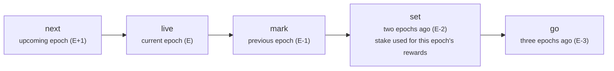
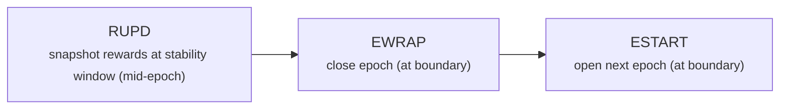

This page is the deepest part of the architecture overview: how Cardano ledger state actually evolves inside Dolos. It stays at a conceptual level — enough to understand the moving parts and where they live in the code. Contributors working on ledger correctness should also read the "Fix Journal" and ledger notes in the repository's `CLAUDE.md`, which document the rules and edge cases in detail.

The Cardano ledger is implemented in the `dolos-cardano` crate as the `CardanoLogic` type, which fulfills the generic `ChainLogic` trait from `dolos-core`.

## Work units

When the sync pipeline hands a block to `CardanoLogic`, it does not mutate state directly — it produces **work units**, the pipelined units of ledger work introduced in the [Sync Pipeline](./sync-pipeline). Cardano defines these variants (`CardanoWorkUnit`):

| Work unit | When | What it does |
| --------- | ---- | ------------ |
| **Genesis** | node bootstrap | Builds the initial ledger from the genesis configuration. |
| **Roll** | every block | Applies a block: inputs, outputs, mints/burns, certificates, withdrawals, and parameter updates. |
| **Rupd** | mid-epoch (stability window) | Computes the epoch's reward distribution from a stake snapshot. |
| **Ewrap** | epoch boundary (close) | Closes the epoch: applies rewards, refunds deposits, enacts governance, and finalizes the pots. |
| **Estart** | epoch boundary (open) | Opens the next epoch: rotates snapshots, transitions pools/DReps/proposals, updates nonces, and advances the era. |
| **ForcedStop** | testing | Halts at a target epoch (used by the integration test harness). |

## The snapshot window

Cardano does not reward stake based on its *current* delegation — it uses delegation as it stood a few epochs earlier, so that the stake distribution used for leader election and rewards is stable and known in advance. Dolos models this with a rotating window of snapshots, `EpochValue<T>`, attached to every entity that participates in staking (accounts, pools, DReps).

Each `EpochValue` holds several named snapshots — the arrows show where each value moves on an epoch transition:

Reward calculations read from the appropriate historical slot (e.g. the `mark`/`set` snapshots), which is why a correct implementation must write each change into the right slot at the right time. Getting a snapshot's timing wrong is a common class of ledger bug.

## Epoch boundary phases

The transition between epochs happens in a defined order — this ordering matters, because rewards, snapshots, and deposit refunds interact.

1. **RUPD** — partway through the epoch, at the randomness-stability window, Dolos snapshots the stake distribution and computes the rewards that will be paid out. Registration status at this moment determines who is eligible.
2. **EWRAP** — at the boundary, the epoch is *closed*: pending rewards are applied to accounts (filtered for anyone who deregistered since RUPD), deposits are refunded, governance actions are enacted, and the treasury/reserves accounting is settled.
3. **ESTART** — the next epoch is *opened*: the snapshot window rotates, pool/DRep/proposal state transitions forward, epoch nonces update, era changes take effect, and the chain cursor advances.

## The pots

Dolos tracks the Cardano money supply as a set of **pots** — reserves, treasury, the rewards pot, the UTxO total, and collected fees — plus outstanding deposits. These satisfy the ledger invariant that they always sum to the fixed maximum supply. During an epoch, changes accumulate as a delta; at the boundary the delta is applied to produce the new pots: monetary expansion is drawn from reserves, the treasury takes its cut, rewards are distributed, and fees roll over. The formulas (monetary expansion η, epoch incentives, and how unspendable rewards are routed) are documented alongside the implementation in `crates/cardano/src/pots.rs` and in `CLAUDE.md`.

## Sharding

The epoch boundary touches every stake account, which on mainnet is a large set. To keep transitions fast, EWRAP and ESTART split the per-account work across a fixed number of shards (`ACCOUNT_SHARDS`), each covering a prefix range of the account key space, and run them one after another before a final global pass. An EWRAP shard builds its per-account deltas in the work-unit `load` step; an ESTART shard reads, rotates and writes its accounts in one pass inside its state commit. Progress is tracked per shard so an interrupted boundary can resume rather than restart.

An ESTART shard deletes an account that is dead once rotated instead of writing it back: unregistered, with no balance, every stake snapshot empty and every delegation snapshot undelegated, and no retired pool. That keeps state bounded by the live accounts rather than every credential the chain has seen. What the API serves of a pruned account that carried history, its lifetime rewards (equal to its lifetime withdrawals) and its newest deregistration, adds to its row in `pruned-accounts` in the same commit; a never-registered account leaves nothing, and `/accounts/{stake_address}` then finds it through the archive's `stake` tag. No sync pass reads `pruned-accounts`, and a credential that comes back starts a fresh row, to which the API adds its pruned history.

A rollback across the boundary can still undo the closing epoch's last blocks. An account that deregistered in the closing epoch therefore waits for the next boundary, so the undo of that deregistration, or of any certificate or withdrawal before it, finds its row. A value paid to a pruned account's address and spent again leaves no trace in its row: when the undo of such a block finds the account gone, the rollback restores a fresh row for it. The undo sets that row's value from before the boundary, lifetime rewards included. Rewards are paid only at EWRAP, and ESTART rotates every row it keeps, so a row at the opening epoch that no boundary rotated has earned nothing itself: the rollback strips its lifetime rewards and withdrawals again, and they stay in `pruned-accounts`, which no rollback changes. Every other row keeps what the undos leave. A row the boundary rotated was never pruned. A row that a closing-epoch block created and that catch-up recreated, at that block's epoch, after a crashed rollback had no row before that block, so the undos give it back at most what the boundary paid it. The rollback reads the epoch only when it restores a row or finds a row with lifetime rewards that no boundary rotated, so a fresh node's first rollback, to the origin before genesis, reads no state.

Source: `crates/cardano/src/{work,model/*,rupd,ewrap,estart,pots,rewards,shard}.rs`.
